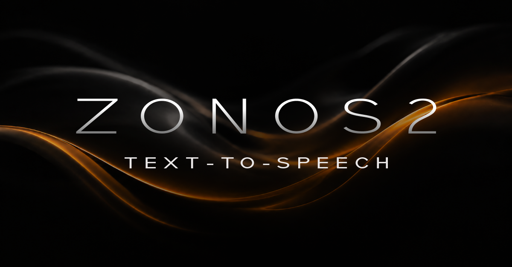

# Zonos 2 (Windows)

## A Get Going Fast Application

### [Quick Setup Helper → GetGoingFast.pro/tools/zonos2-win](https://getgoingfast.pro/tools/zonos2-win/)

The ready-to-run Windows installer is available to Get Going Fast members on the tool page above. This repository contains the application source, not the member installer ZIP or model weights.

Create speech from text, clone a reference voice, blend voices and adjust expression in a simple GGF interface. The PC performs inference; a phone can control it through the same app.

## Manual installation from source

These are the manual steps for this public repository. The separate member download on the tool page provides the guided installer. Use Windows 64-bit, a current NVIDIA driver for CUDA mode, an AVX2-capable CPU, and at least 12 GB of free space. Install [Git for Windows](https://git-scm.com/download/win) and [uv](https://docs.astral.sh/uv/getting-started/installation/) first; neither the model weights nor the native engine is committed here.

1. Open **Command Prompt** in a writable folder on an internal drive and get the source:

   ```bat
   git clone https://codeberg.org/Cognibuild/GGF-Zonos2.git
   cd GGF-Zonos2
   ```

2. Create the private Python 3.11 environment and install the app dependencies:

   ```bat
   uv venv --managed-python --python 3.11 .venv
   uv pip install --python .venv\Scripts\python.exe -r requirements.txt
   uv pip check --python .venv\Scripts\python.exe
   ```

3. Download the [native Windows engine release](https://github.com/gjnave/GGF-Zonos2/releases/tag/native-v0.5.2), `GGF-Zonos2-native-v0.5.2-windows-x64.zip`. Verify its SHA-256 is `52664aadf24cd18a5297a5bf616e4e010d707572ed4dedbd99b3778af8b6f559`, 
certutil -hashfile "GGF-Zonos2-native-v0.5.2-windows-x64.zip" SHA256

then extract it into this repository folder. Copy `web\tts_ui.html` to `zonos2\web\tts_ui.html`. The extracted tree must contain both `zonos2\zonos2-server.exe` and `zonos2\cuda\zonos2-server.exe`.

4. Download `zonos2-q6_k.gguf`, `dac.gguf`, and `spk-encoder.gguf` from the pinned [Zyphra ZONOS2-GGUF revision](https://huggingface.co/Zyphra/ZONOS2-GGUF/tree/75c877ec8ac86dda42bfc0e9968c87f29e10ef57) into `zonos2\models\`. Verify their SHA-256 hashes, respectively: `349175207ce6521d4e89e2317f7862c68d15b8ee5ad876c1c3ce2938dc5c7e86`, `b5330fc112cfac5e7bae511a5083915ce5028899de4d7a4193dcc5874063532c`, and `284849980047a811e2c2a13ce7527c8a6a286021df152e5325533d783240eb6d`. In Command Prompt, `certutil -hashfile PATH SHA256` checks one file.

5. Run `.venv\Scripts\python.exe launch-native.py --check-environment`, then double-click `run.bat` (or run `.venv\Scripts\python.exe app.py`). The installer, models and runtime are not bundled in this source repository.

The default UI is http://127.0.0.1:7865 with occupied-port fallback. Native inference is a hidden app-owned loopback process that loads only when you generate. This is not ComfyUI, WSL or PyTorch inference. Native Windows CUDA and CPU builds use an AVX2 CPU baseline. CUDA was tested on RTX 4090 only; other GPU hardware is unverified. For CPU mode, set ZONOS2_BACKEND=cpu before running.

## Use from your phone

Open Settings → Use from your phone / network access. Choose Local network (same LAN) or Temporary public link. Enter an optional username/password; blank password means no login. Save, then use Restart app / apply saved settings. Return to Settings to copy the current phone address. Your PC must stay on. Local access always remains login-free; remote authentication uses a separate Gradio address. Passwords are stored only as salted hashes. Public links change on restart and anyone with an unauthenticated link can use the app and Settings. LAN access may require Windows Firewall permission. There is no separate phone launcher.

## Create

Type or paste the words to speak. Choose a preset, or upload/record a reference voice you have permission to use. Expression sliders stay in their own open panel immediately above Generate; technical controls are in the collapsed Parameters panel. Generate creates a unique WAV in outputs. Long scripts are chunked without a total-duration cap. If a chunk reaches its selected native token limit, the result warns about possible cutoff. Stop generation releases the owned engine. Release models in Settings frees GPU memory while keeping the UI and phone link open; next generation reloads automatically. Stop server requires confirmation and requires a local-PC restart afterward.

Uploads, controls and results are kept in a browser-token workspace on disk, so reopening the same browser origin restores them. New public URLs are different origins; browser-local workspace identifiers do not automatically transfer to a new URL. Light/Dark appearance is remembered on each device.

## Updates and publication

Settings checks repository revisions and stages host-generated repository archives before copying source. Existing files are backed up; installed models, environments, private settings, outputs and native binaries are preserved. Dependency updates use UV. Ordinary UI/source updates do not rebuild the native engine release.

Application source is published as individual files on [Codeberg](https://codeberg.org/Cognibuild/GGF-Zonos2) and [GitHub](https://github.com/gjnave/GGF-Zonos2). The separate member installer tries Codeberg first and falls back to GitHub if unavailable. Native binaries are downloaded as a separately versioned GitHub release asset; they are not bundled in the small member installer ZIP. No verified Drive fallback is configured; do not claim one.

## Notices

Keep licenses/ and THIRD-PARTY-NOTICES.md with the downloaded application. Published upstream license texts are retained without assigning a model/Python license to the separate native C++ project. The installer retains the user's original about.nfo and disclaimer.md unchanged; its legacy WSL description refers to the prior bundle, not this native app.
